# G1Control

Control a Unitree G1 humanoid robot with your body, using only a webcam.

- **Gesture mode:** hold a hand gesture and the robot walks, steps sideways or turns.
- **Mimic mode:** the robot's arms follow your arms (simulation only).

Everything runs in the Unitree MuJoCo simulator first. The same program can also send walking commands to a physical G1.

| Document | What it covers |
| --- | --- |
| [SETUP.md](SETUP.md) | Installing everything on a fresh Ubuntu 22.04 machine |
| [USAGE.md](USAGE.md) | Running the program in simulation and on the real robot, re-recording gestures, troubleshooting |
| README.md (this file) | What the project is, how it fits together, glossary and FAQ |

---

## Contents

1. [Project status](#1-project-status)
2. [Gestures](#2-gestures)
3. [How the system fits together](#3-how-the-system-fits-together)
4. [Operating modes](#4-operating-modes)
5. [Start-up sequence](#5-start-up-sequence)
6. [Repository layout](#6-repository-layout)
7. [Glossary](#7-glossary)
8. [FAQ](#8-faq)
9. [Third-party software](#9-third-party-software)

---

## 1. Project status

| Feature | Simulation | Real G1 |
| --- | --- | --- |
| Gesture mode | Working | Implemented, **not yet tested on a physical robot** |
| Mimic mode | Working | Not available |

See [USAGE.md section 4](USAGE.md#4-run-on-the-real-g1) before using the real robot.

---

## 2. Gestures

Hold a gesture to move; lower your hand to stop.

| Gesture | Robot action | Photo |
| --- | --- | --- |
| `move_forward_left_hand` | Walk forward | 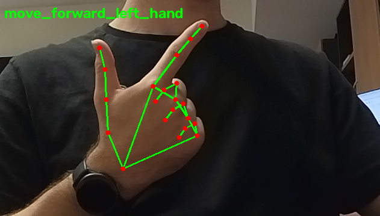 |
| `move_forward_right_hand` | Walk forward | 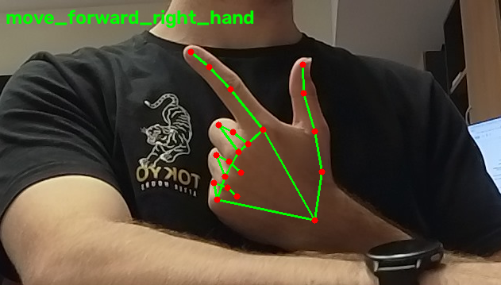 |
| `move_backward_left_hand` | Walk backward | 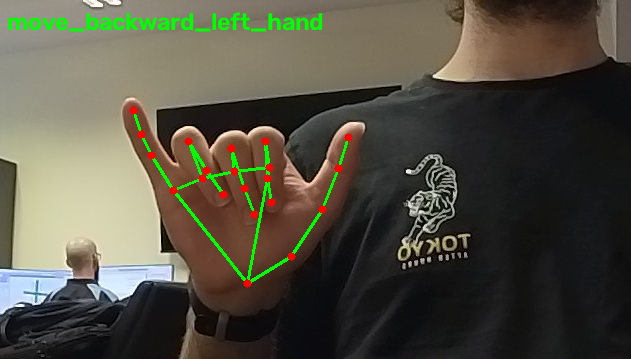 |
| `move_backward_right_hand` | Walk backward | 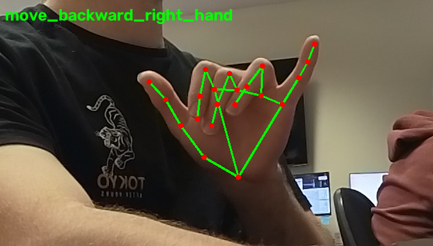 |
| `move_left` | Step sideways to the left | 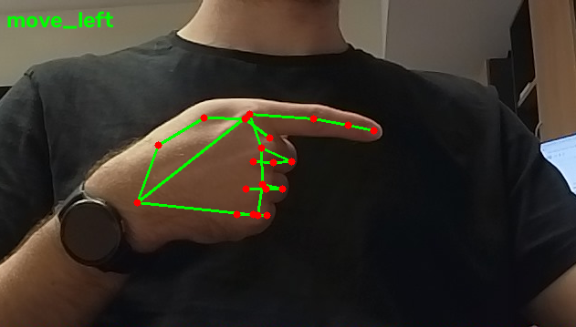 |
| `move_right` | Step sideways to the right | 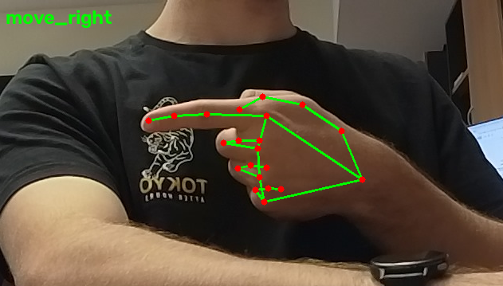 |
| `turn_left` | Turn left | 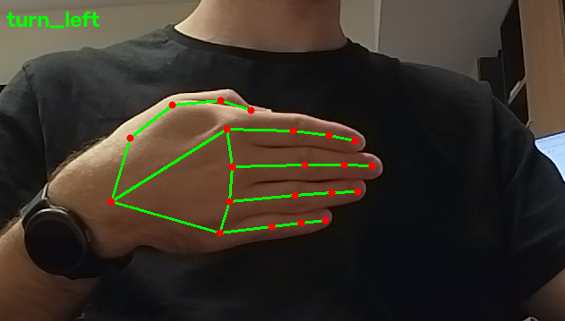 |
| `turn_right` | Turn right | 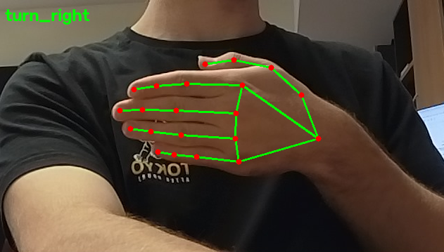 |

If recognition is unreliable for a new operator, camera or lighting, the gestures can be re-recorded ([USAGE.md section 5](USAGE.md#5-re-record-gestures)).

---

## 3. How the system fits together

### In simulation

Three programs run at the same time, each in its own terminal. They talk to each other over DDS, the same messaging layer the real robot uses, on the loopback interface `lo`.

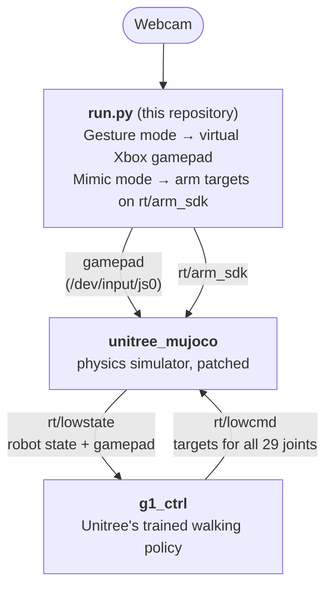

- **Gesture mode:** `run.py` recognises a hand gesture and moves the sticks of a virtual Xbox controller. The simulator passes the gamepad state to `g1_ctrl`, which walks the robot.
- **Mimic mode:** `run.py` tracks the operator's body, retargets the arm pose onto the G1 with GMR, and publishes arm joint targets on `rt/arm_sdk`. The project's patched simulator blends these into the arm motors while `g1_ctrl` keeps the legs balanced.

### On the real robot

The simulator and `g1_ctrl` are not used. `run.py` sends walking commands straight to the G1's built-in walking controller, over the same WiFi network.

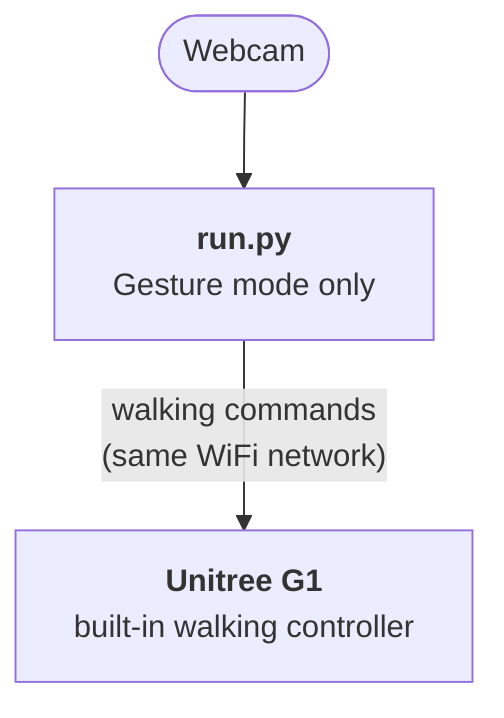

---

## 4. Operating modes

What the program is doing at each point in simulation, and what moves it to the next state.

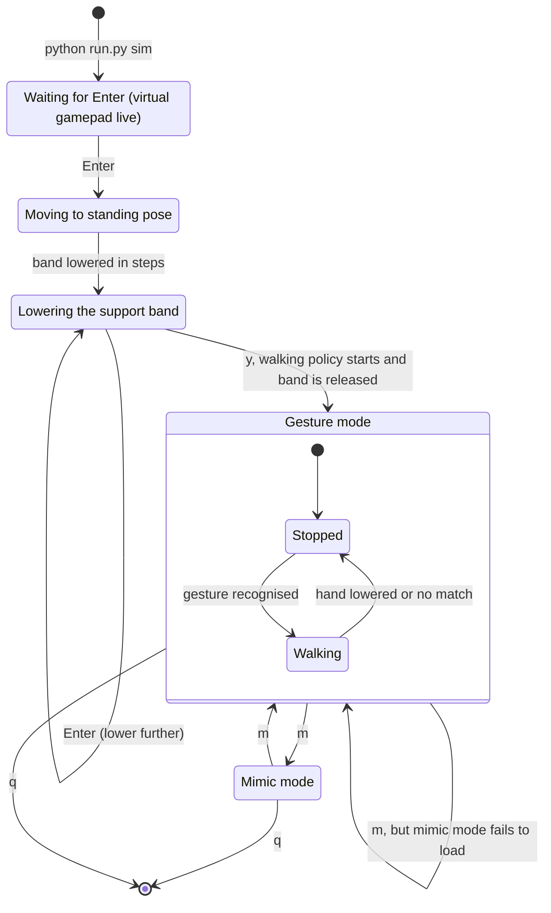

On the real robot (`python run.py real`) there is no start-up sequence and no mimic mode: the robot must already be standing, and the program goes straight to gesture mode.

---

## 5. Start-up sequence

Why the three programs must be started in a fixed order, and what happens during start-up. Step-by-step instructions are in [USAGE.md section 3](USAGE.md#3-run-in-simulation).

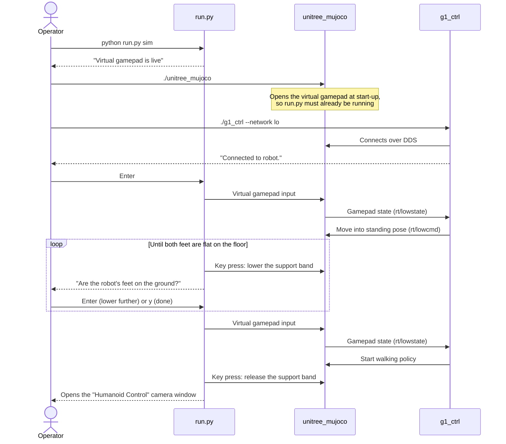

---

## 6. Repository layout

The main files and folders:

```text
G1Control/
├── run.py                       the program you run (sim or real)
├── src/
│   ├── recognize_hand_gestures.py   test gesture recognition on its own
│   ├── record_hand_gestures.py      record new gesture samples
│   ├── real_controller.py           controller for the physical G1
│   └── data/gestures.json           recorded gesture samples
├── gesture_library/             photo of each gesture
├── unitree_mujoco_patch/        patched simulator bridge and config.yaml
├── apt-packages.txt             system packages (SETUP step 4)
├── requirements.txt             Python packages (SETUP step 7)
├── README.md
├── SETUP.md
└── USAGE.md
```

Third-party code is not stored in this repository. SETUP.md installs it into a `Dependencies/` folder next to the project folder.

Older and outdated code is kept on the `Legacy` branch.

---

## 7. Glossary

| Term / acronym | Explanation | Further info |
| --- | --- | --- |
| Unitree G1 | The humanoid robot this project controls. The project uses the 29-joint version. | [unitree.com/g1](https://www.unitree.com/g1) |
| DDS | Data Distribution Service: the publish/subscribe messaging system the G1 uses. Programs exchange data by publishing to and subscribing to named **topics**. | [OMG DDS](https://www.omg.org/spec/DDS/) |
| CycloneDDS | The open-source DDS implementation the Unitree SDK uses. | [cyclonedds.io](https://cyclonedds.io) |
| DDS domain | A number that separates groups of DDS programs. Programs only see each other on the same domain. This project uses domain `0`. | [cyclonedds.io](https://cyclonedds.io) |
| `rt/lowstate` | DDS topic carrying the robot's state (and, in simulation, the gamepad state). | [unitree_sdk2](https://github.com/unitreerobotics/unitree_sdk2) |
| `rt/lowcmd` | DDS topic carrying joint targets for all 29 joints. | [unitree_sdk2](https://github.com/unitreerobotics/unitree_sdk2) |
| `rt/arm_sdk` | DDS topic carrying arm joint targets. Used by mimic mode. | [unitree_sdk2](https://github.com/unitreerobotics/unitree_sdk2) |
| `lo` (loopback) | The network interface that only talks to the same computer. In simulation, all three programs communicate over `lo`. | - |
| Unitree SDK | Unitree's C++ (`unitree_sdk2`) and Python (`unitree_sdk2_python`) libraries for talking to the G1 over DDS. | [C++](https://github.com/unitreerobotics/unitree_sdk2), [Python](https://github.com/unitreerobotics/unitree_sdk2_python) |
| MuJoCo | A physics simulator. | [mujoco.org](https://mujoco.org) |
| `unitree_mujoco` | Unitree's G1 simulator built on MuJoCo. It speaks DDS, so programs treat it like the real robot. | [GitHub](https://github.com/unitreerobotics/unitree_mujoco) |
| Simulator patch | The project's modified `unitree_sdk2_bridge.h` (in `unitree_mujoco_patch/`), which lets mimic mode control the robot's arms. | [SETUP.md step 11](SETUP.md#11-simulator-unitree_mujoco) |
| Support band | A virtual harness in the simulator that holds the robot up while it gets into a standing pose. It is lowered and then released at start-up. | [USAGE.md 3.2](USAGE.md#32-start-up-sequence) |
| `g1_ctrl` | The program from Unitree's `unitree_rl_lab` that runs a pretrained walking policy and keeps the robot balanced. | [GitHub](https://github.com/unitreerobotics/unitree_rl_lab) |
| Walking policy | A trained neural network that turns movement commands into leg joint movements. | - |
| ONNX Runtime | The library `g1_ctrl` uses to run the walking policy. | [onnxruntime.ai](https://onnxruntime.ai) |
| MediaPipe | Google's library for detecting hands and body pose in camera images. Uses the two `.task` model files. | [MediaPipe](https://developers.google.com/edge/mediapipe/solutions/guide) |
| Landmarks | The key points MediaPipe detects, such as finger joints or shoulders and elbows. | - |
| GMR | General Motion Retargeting: converts a human pose into joint angles for a robot with a different body shape (**retargeting**). | [GitHub](https://github.com/YanjieZe/GMR) |
| Virtual gamepad | A software Xbox 360 controller created by `run.py` with the `vgamepad` library. Gesture mode moves its sticks to drive the simulated robot. | [vgamepad](https://github.com/yannbouteiller/vgamepad) |
| `/dev/uinput` | The Linux device that lets programs create virtual input devices such as the gamepad. | [kernel.org](https://www.kernel.org/doc/html/latest/input/uinput.html) |
| Xorg / Wayland | The two display systems Ubuntu can use. This project needs Xorg. | [SETUP.md section 1](SETUP.md#1-requirements) |
| `xdotool` | A tool that sends key presses to windows. Used to lower and release the support band. | [GitHub](https://github.com/jordansissel/xdotool) |
| Virtual environment (`g1-env`) | A self-contained Python installation for this project, so its packages don't clash with the system's. | [Python docs](https://docs.python.org/3/library/venv.html) |
| Commit hash (e.g. `4134cb5`) | An ID for an exact version of a git repository. SETUP.md pins each third-party repository to the version the project was tested with. | [SETUP.md step 6](SETUP.md#6-third-party-repositories) |

---

## 8. FAQ

Questions about *why* things work the way they do. For problems ("it isn't working"), see the Troubleshooting sections in [SETUP.md](SETUP.md#15-troubleshooting) and [USAGE.md](USAGE.md#6-troubleshooting).

**Why does it need Xorg and not Wayland?**
The program lowers and releases the simulator's support band by pressing keys in the MuJoCo window with `xdotool`, which only works under Xorg.

**Why are there three separate programs in simulation?**
Each has one job: `run.py` turns the camera image into commands, `unitree_mujoco` simulates the robot, and `g1_ctrl` keeps it balanced and walking. They talk over DDS, the same messaging layer the real robot uses.

**Why must `run.py` start before the simulator?**
`run.py` creates the virtual gamepad, and the simulator only looks for a gamepad when it starts.

**Why can't I start the simulator on its own to test it?**
The project's `config.yaml` tells the simulator to read the virtual gamepad, which only exists while `run.py` is running. Started alone, it prints `Error: Joystick open failed.` and closes.

**Why does the robot hang from a band at the start?**
The support band holds the robot up while it gets into a standing pose. The program lowers it in steps and releases it once both feet are flat on the floor.

**Why does the simulator need patched files?**
The patched `unitree_sdk2_bridge.h` lets mimic mode control the robot's arms. The project's `config.yaml` loads the 29-joint G1, uses DDS domain `0` on `lo` to match `g1_ctrl`, reads the virtual gamepad, and enables the support band.

**Why are the third-party repositories pinned to specific versions?**
They are the versions the project was tested with. For `unitree_mujoco` the pin is required, because the project's simulator patch is written for that exact version.

**Why is MuJoCo installed twice?**
They are different things: the MuJoCo 3.3.6 C++ library is what the simulator is built on, and the `mujoco` Python package is installed separately with the other Python packages.

**Why must the folder be called `Dependencies` and sit next to the project?**
The program finds its third-party files and models by looking for a folder named exactly `Dependencies/` next to the project folder.

**Why does the camera image freeze the first time I switch to mimic mode?**
The models load the first time you switch. This takes a few seconds, and the image freezes during that time.

**Why are the arms and the real robot slowed down?**
In mimic mode, arm speed is capped because fast two-arm movements can tip the robot over. On the real robot, walking and turning speeds are deliberately lower than in simulation (0.3 m/s and 0.3 rad/s).

**Why doesn't mimic mode work on the real robot?**
Only gesture mode is available on the real robot. There, `run.py` sends walking commands directly to the G1's built-in walking controller.

**Why do I need to edit the code to use the real robot?**
The real-robot controller defaults to the network interface `wlan0`, but the WiFi interface has a different name on most Ubuntu laptops. Set yours in `src/real_controller.py` ([USAGE.md section 4](USAGE.md#4-run-on-the-real-g1)).

**Where did the older code go?**
Old and outdated files are kept on the `Legacy` branch.

---

## 9. Third-party software

This project builds on:

- [unitree_sdk2](https://github.com/unitreerobotics/unitree_sdk2) and [unitree_sdk2_python](https://github.com/unitreerobotics/unitree_sdk2_python): Unitree SDKs
- [unitree_mujoco](https://github.com/unitreerobotics/unitree_mujoco): G1 simulator
- [unitree_rl_lab](https://github.com/unitreerobotics/unitree_rl_lab): pretrained walking policy (`g1_ctrl`)
- [GMR](https://github.com/YanjieZe/GMR): motion retargeting
- [MediaPipe](https://developers.google.com/edge/mediapipe/solutions/guide): hand and pose detection
- [CycloneDDS](https://cyclonedds.io): DDS messaging
- [MuJoCo](https://mujoco.org): physics engine

Exact versions are listed in [SETUP.md](SETUP.md#16-tested-versions).


